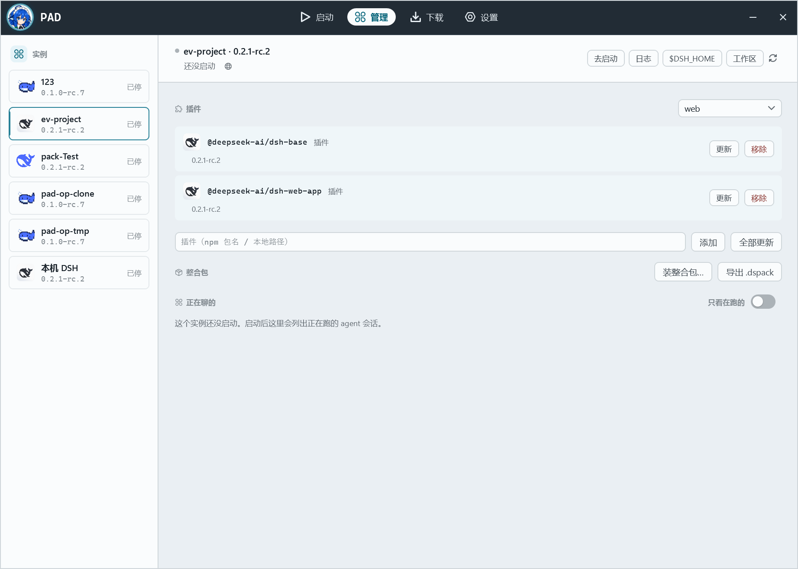
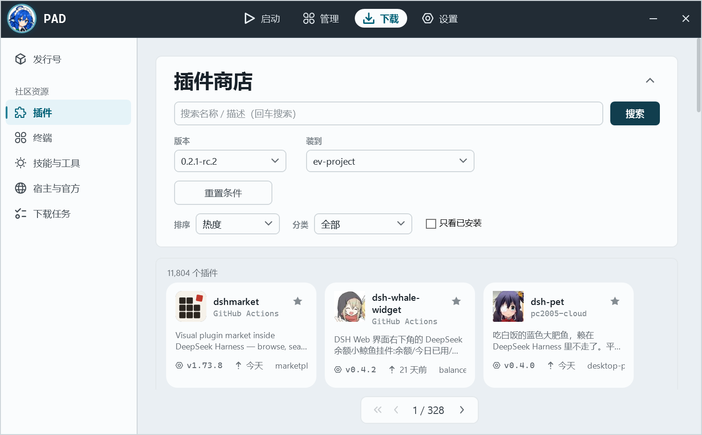
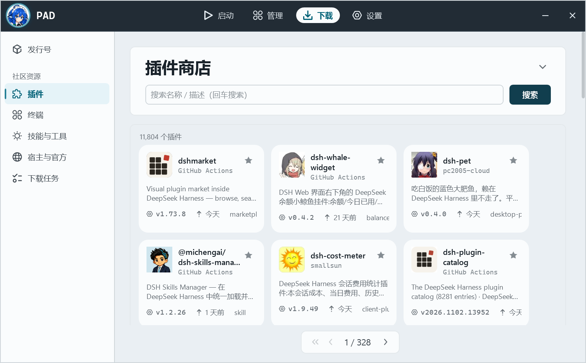
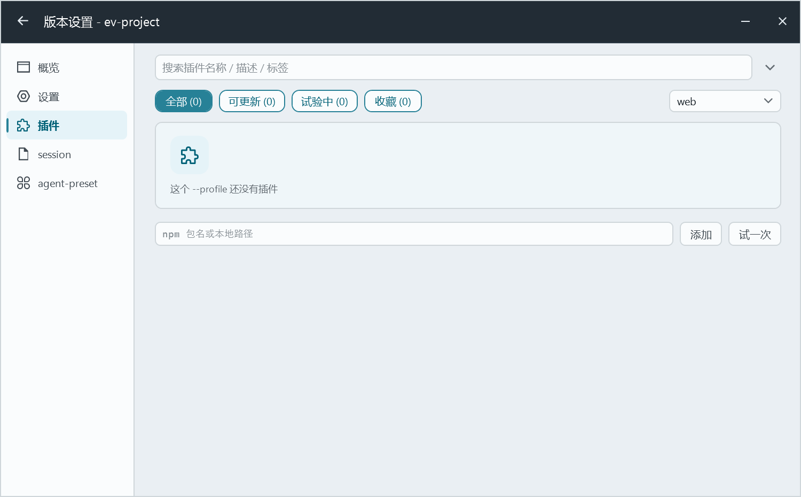
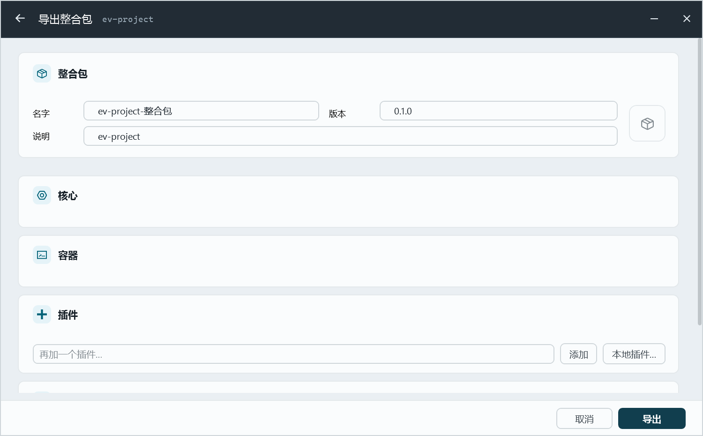

# D108 · 合并后 PAD 界面效果（截图）

日期：2026-11-02｜状态：记录用（`pad/lead-repo-images` 合并 + packforge 导出入口）

截图方式：`pack-agent-for DSH.exe --shot <png> --shot-page <page> --shot-exit`，隔离/真实 launcher root（`.pack-launcher`），无头自动渲染。

## 01 · 管理页：实例 + 「导出 .dspack」

- 左侧实例名册（123 / ev-project / pack-test / pad-op-clone / pad-op-tmp / 本机 DSH）
- 「整合包」行新增 **导出 .dspack**（本会话 packforge 反向导出入口；之前只放在不可达的 InstanceView PanePacks，已挪到正常可达的管理页）
- 旁边是原生「装整合包…」（`.pack.zip` / `.pack.json` / `.pinst.zip`）

## 02 · 插件商店：筛选/版本/排序/只看已安装

来自吸纳的 `pad/lead-repo-images` 分支（11 commits）：商店头可折叠、版本选择、排序（热度…）、分类筛选、只看已安装、「装到」实例选择。

## 03 · 插件商店：卡片网格 + 分页

同一分支的卡片网格与分页（1 / 328），以及仓库图标/作者/版本/更新时间信息行。

## 04 · 实例页：插件（收藏/试验中/可更新分类）

`pad/lead-repo-images` 的插件列表分页/筛选/收藏 tab 也在这里生效。

## 05 · 原生「导出整合包」（对照）

原有 PAD 整合包导出（`.pack.zip` 系）。与 01 的新「导出 .dspack」是两条不同通道：前者是 PAD/Claude 等 harness 的原生包，后者是 PackForge 生态可装的 `.dspack`。

## 验证

- `dotnet build` PAD 0 警告 0 错误
- `bun run agent-pack-dsh/modpack/pad-dspack-ui.test.ts` 通过（新增 ManageView 导出按钮/处理函数契约）
- 本目录无敏感内容（截图来自开发机实例列表，无凭据）
