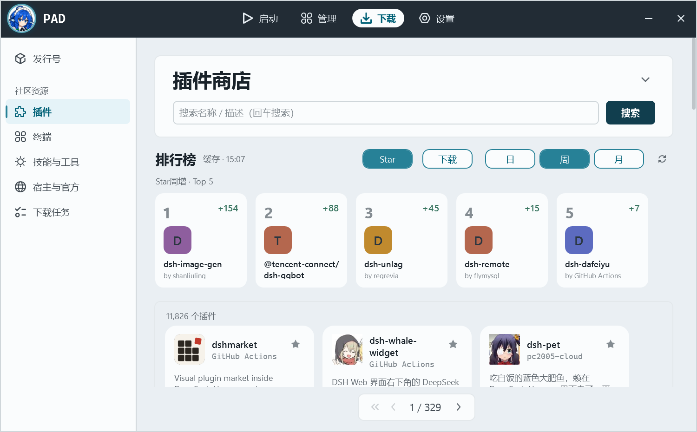

# D109 · 插件商店提速 + 下载/Star 增长榜

日期：2026-11-02｜状态：**已实现并验证**

## 1. 商店加载提速

| 改动 | 文件 | 效果 |
|---|---|---|
| 内存页缓存 + 进行中请求合并（5 min） | `pad/Core/Market.cs` | 切回同一页/同一货架不再打 npm；并发相同请求只发一次 |
| 磁盘页缓存（`%LOCALAPPDATA%\pack-agent-dsh\market-cache`，5 min） | `pad/Core/Market.cs` | 重开 PAD / 重进商店也不等 npm |
| 下一页预取 | `pad/Views/DownloadView.xaml.cs` | 点“下一页”通常直接命中缓存 |
| 图标并行（并发 6，替代逐个 await） | `pad/Views/DownloadView.xaml.cs` | 商店首屏图标更快补齐 |
| CLI 显示缓存命中 | `pad/Core/Cli.cs` | `pad cli market plugin` 打印 `搜索 N ms` / `缓存` |

实测（同一台机、同一查询）：

```
冷启动（磁盘缓存空）：插件商店第 1 页  搜索 1680 ms
新进程（磁盘缓存命中）：              搜索 0 ms（缓存）
```

## 2. 增长榜（下载日/周/月 + Star 日/周/月）



数据源：

- **下载**：npm `downloads/range`，每个候选包一次请求，得到逐日下载；日/周/月增长 = 相邻窗口差（npm 尾部有滞后零值，按“最后一个有数据的天”锚定）
- **Star**：GitHub 新接口 `GET /repos/{owner}/{repo}/stargazers/history`（隐私安全、按周返回 `days[]`，无需登录），日/周/月增长 = 相邻窗口差
- 候选：npm 搜索 `keywords:dsh-plugin` 按热度取前 30；聚合结果缓存 6h（`<launcher>/library/cache/market/leaderboards.json`），Star 数据另做 12h 单仓缓存，避免反复消耗 GitHub 匿名配额（可选 `PAD_GITHUB_TOKEN` 提高配额，UI 会提示）

入口：

- UI：**并入插件商店页**（App Store 式 Top Charts 横排，不再单开页面/货架）：Star/下载 × 日/周/月，Top 5 卡片刻度；点卡片走同一个插件详情窗口（PluginDetailWindow）
- CLI：`pad cli market ranking [--refresh] [--out ranking.json]`（`--out` 输出 JSON）

真实数据实测（2026-11-02 15:07，候选 30，Star 30/30 全部取到）：

```
Star日增   dsh-genui +0 / dsh-dream-skin -1 / dsh-univer-office -3
Star周增   dsh-image-gen +154 / @tencent-connect/dsh-qqbot +88 / dsh-unlag +45
Star月增   dsh-ops +5,025 / dsh-pet +3,783 / dsh-plugin-wallpaper-engine +3,681
下载日增   dsh-plugin-catalog +4,573 / dsh-connect-workbuddy +2,439
下载周增   dshmarket +186,498 / dsh-pet +178,799
下载月增   dshmarket +348,483 / dsh-pet +279,679
```

完整样例：`ranking-sample.json`（`--out` 产物）。


## 4. 测试

- `pad.tests/MarketMetricsTests.cs`（新增 14 项）：窗口差（日/周/月）、npm range 解析、GitHub 周桶展开、repo slug 解析
- `dotnet test`：**42 项全部通过**
- `dotnet build`：0 警告 0 错误

## 5. 边界

1. 下载增长基于 npm 公开统计；私有包/未发布包没有数据。
2. Star 增长依赖 GitHub API；匿名配额被其他程序共享时榜单会变短（有 token 或等配额恢复后补齐）。
3. 候选集是「npm 热度前 30」，不是全量 11,806 个包（全量需要上万个请求，不现实）。
4. 榜单按“候选包”聚合；同一仓库多个 npm 包会分别出现（未按仓库去重）。
5. 排行榜首次打开约 10–20 秒（30 个 npm + 30 个 GitHub 请求，并发限流）；之后 6h 内直接命中磁盘缓存。
