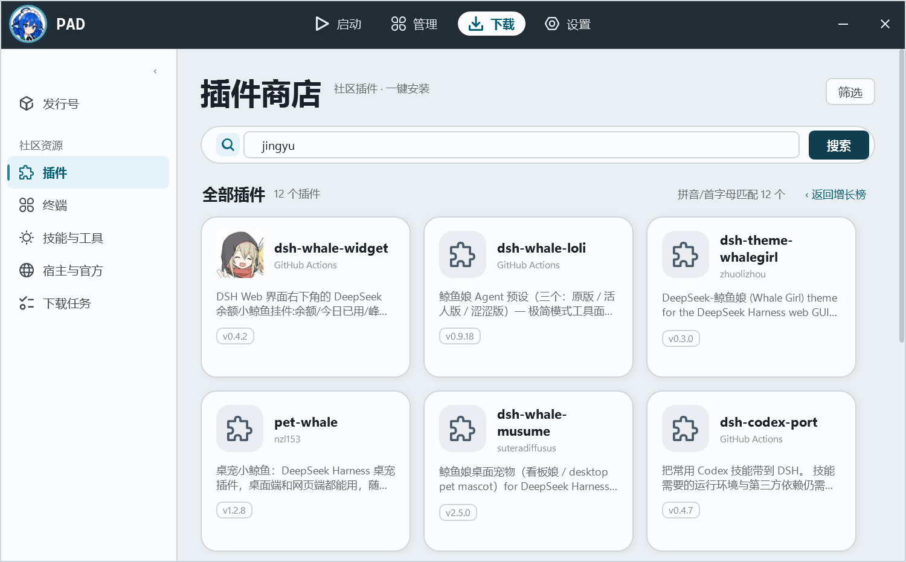

# D111 · 商店搜索：拼音 / 首字母

日期：2026-11-02｜状态：**已实现并验证**



## 1. 搜索现在的完整链路

1. npm registry 全文搜索（`/-/v1/search`，`keywords:dsh-plugin <词>`），名称/描述/关键词相关性
2. 本地精确命中优先（`Market.RankForQuery`：包名命中 > 名称含所有词 > 描述/关键词命中；忽略 `- _ . @scope` 与大小写）
3. 无精确命中提示：「没有精确命中 · 按 npm 相关性显示」
4. 货架内无结果 → 跨货架兜底（去掉 `keywords` 限定，只留名字/描述含 `dsh`/`deepseek` 的包，提示「已跨货架找到 N 个」）
5. **拼音 / 首字母兜底**：查询是纯 ASCII（≥2 字母）且包名没有命中时，查本地拼音索引；提示「拼音/首字母匹配 N 个」

## 2. 拼音 / 首字母怎么做的

- 拼音表：`pinyin-data 0.16.0`（mozillazg/pinyin-data），取首个读音、去声调，编码为 `0x4E00–0x9FFF` 的 3 位十六进制索引（`pad/Core/PinyinData.cs`，约 66KB，覆盖 20,992 个常用汉字，407 个音节）
- 转换：`PinyinSearch.Convert(text)` →（全拼，首字母）；只对汉字取音，ASCII 原样保留
- 索引：`MarketPinyinIndex` 只缓存 **npm 热度前 3000** 个 DSH 插件（12 页 × 250），24h 一次，文件在 `<launcher>/library/cache/market/pinyin-index.json`（约 2.3MB）；条目预存全拼与首字母
- 匹配：全拼包含查询 +3，首字母包含查询（≤6 字母）+2，再按 npm 热度排序，最多 12 个
- 命中后仍复用商店卡片与 `PluginDetailWindow`

## 3. 实测

```
pad cli market pinyin jingyu
→ dsh-whale-widget / dsh-whale-loli / dsh-theme-whalegirl / pet-whale / dsh-whale-musume …

pad cli market pinyin jy
→ 首字母匹配（dsh-whale-widget 等）

pad cli market pinyin qqjiqiren
→ dsh-qqbot-lite 等
```

UI：输入 `jingyu` → 首条就是 dsh-whale-widget。

## 4. 边界

1. 索引只覆盖热度前 3000，长尾插件可能不在；24h 重建
2. 首字母匹配天然有歧义（`jy` = 鲸鱼/记忆/经验…），同分按热度排
3. 第一次拼音搜索要建索引（12 页，约 10 秒，区块右侧显示进度）；之后读缓存
4. 拼音表只覆盖基本汉字区（0x4E00–0x9FFF），扩展区汉字不参与拼音

## 5. 验证

- `dotnet build`：0 警告 0 错误
- `dotnet test`：**57 项全过**（搜索/拼音新增 10 项：`MarketSearchTests`、`PinyinSearchTests`）
- UI 契约测试：通过
- 索引文件实测 2,314,732 字节，12 页 × 250 抓取 9.4 秒（首次）
