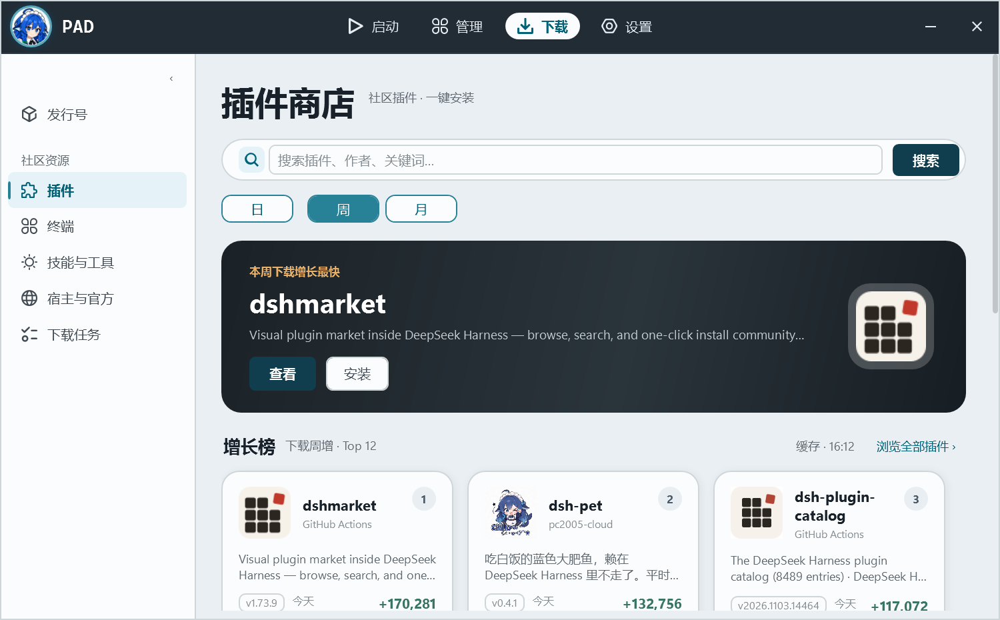
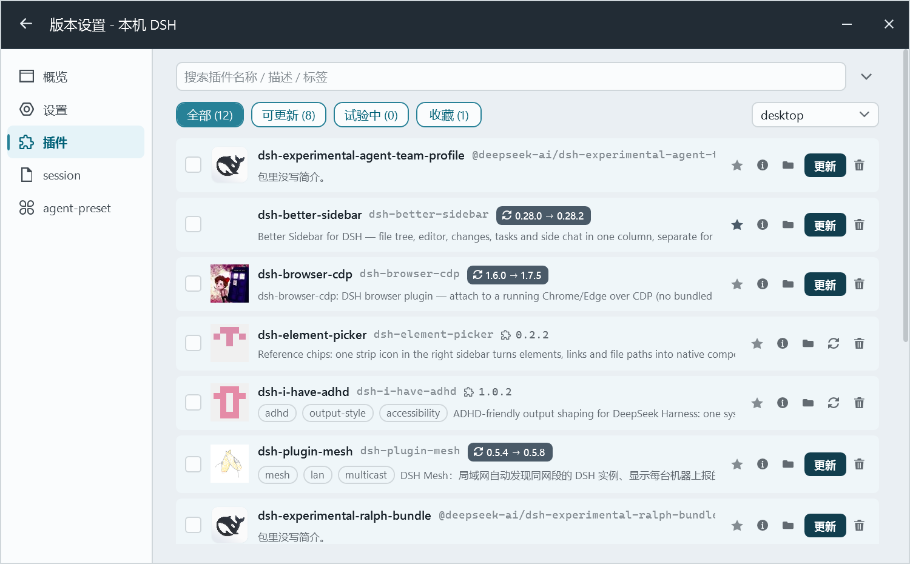

# D112 · npm 官方自定义 icon

日期：2026-11-03｜状态：**已实现并验证**

npm 现在支持包在 `package.json` 里声明 `icon`（包内相对路径，如 `assets/logo.png`、`./icon.png`、`assets/logo.svg`）。PAD 商店之前只从 GitHub 仓库头像取图标，现在**优先用官方 package icon**。



## 实现

- `pad/Core/NpmPackageIcon.cs`
  - 按包名查一次 `https://registry.npmjs.org/<name>/latest`（6h 内存缓存），读 `version` + `icon`
  - 相对路径 → `https://cdn.jsdelivr.net/npm/<name>@<version>/<icon>`
  - PNG / JPG / GIF 直接缓存到 `<launcher>/library/plugins-meta/<name>/icon-npm.*`
  - **SVG** 用新的 `BundleIcon.TryRasterizeSvg` 光栅化成 `icon-npm.png`（64×64）
  - 没有 `icon` 字段 / 下载失败 / 格式不支持 → 回退原来的仓库 logo（`BundleIcon.EnsureFromRepo`）
- 加载顺序：`NpmPackageIcon.EnsureAsync` → `BundleIcon.EnsureFromRepo` → 占位字形
- 生效范围：商店卡片、Hero、增长榜卡片、插件详情窗口（都读 `MarketRow.IconPath`）
- CLI：`pad cli market icon <包名>` 可直接验证

## SVG 光栅化（重写）

旧的 `TryRasterizeSvg` 只认 `<path>`，而 npm 图标常见 `<rect>` + `<g transform>`（如 dshmarket 的 logo）。已改成用 XDocument 解析：

- 形状：`rect`（含圆角）/ `circle` / `ellipse` / `path` / `line` / `polygon` / `polyline`
- 继承：`<g>` 的 `fill`、`style="fill:..."`、`#rgb/#rrggbb/rgb()`
- 变换：`translate` / `scale` / `rotate` / `matrix` / `skewX` / `skewY`，按 SVG 从右到左组合
- 忽略不支持的滤镜/渐变/use，退回纯色近似

## 实测

```
pad cli market icon dsh-pet
→ ...\plugins-meta\dsh-pet\icon-npm.png (25,058 bytes, 来自 assets/logo.png)

pad cli market icon dsh-whale-widget
→ ...\plugins-meta\dsh-whale-widget\icon-npm.png (来自 ./icon.png)

pad cli market icon dshmarket
→ ...\plugins-meta\dshmarket\icon-npm.png (1,366 bytes, 由 assets/logo.svg 光栅化)
```

商店截图里 dsh-pet 已从 GitHub 头像换成 npm 包自带图标。

## 1. 图标加载加速

- 图标文件命中时**完全不联网**：EnsureAsync 先查 library/plugins-meta/<包>/icon-npm.*，有就直接返回
- /latest 元数据落盘缓存（library/cache/market/npm-icons.json，24h），重开 PAD 不再逐包请求 registry
- 实测 pad cli market icon dsh-ops（含进程启动）：冷 4.0s（下载 119KB 图标）→ 热 1.0s（只读本地文件）

## 2. 已安装列表也用来源图标

- BundleIcon.Resolve 先读包内 package.json 的 icon（本地文件，SVG 光栅化）
- 本地没有时，BundleIcon.Ensure 先试 npm 官方 icon，再退回仓库 logo
- 版本设置/管理页图标加载完成后会重绘行，冷启动时异步补齐

## 边界

1. 搜索接口不返回 `icon`，所以每个包多一次 `latest` 请求（6h 缓存；图标文件缓存后不再下载）
2. WebP/BMP 等格式未转换，直接回退仓库 logo
3. SVG 只实现常用子集（无渐变/滤镜/`<use>`），复杂图标可能失败并回退
4. 已安装插件列表也走同一套：BundleIcon.Resolve 先读包内 package.json 的 icon（SVG 光栅化到缓存），再退回默认图标文件 / 仓库 logo

已安装插件列表（版本设置 → 插件）：



## 验证

- `dotnet build`：0 警告 0 错误
- `dotnet test`：**63 项全过**（新增 `NpmPackageIconTests` 6 项：latest 解析、缺 icon、坏 JSON、jsDelivr URL）
- 截图：`01-store-icons.png`
