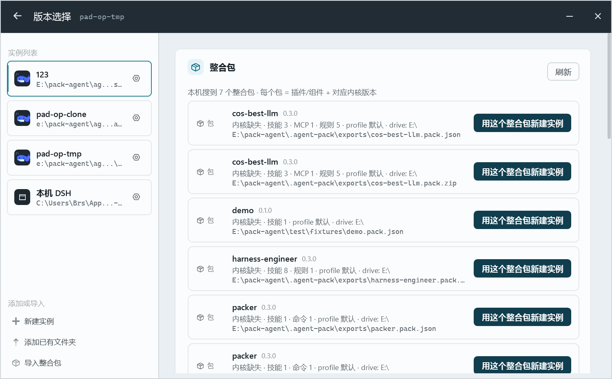
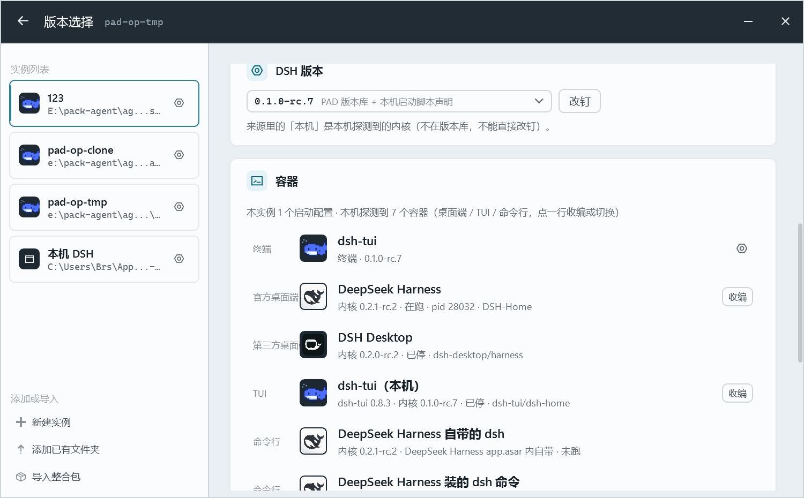
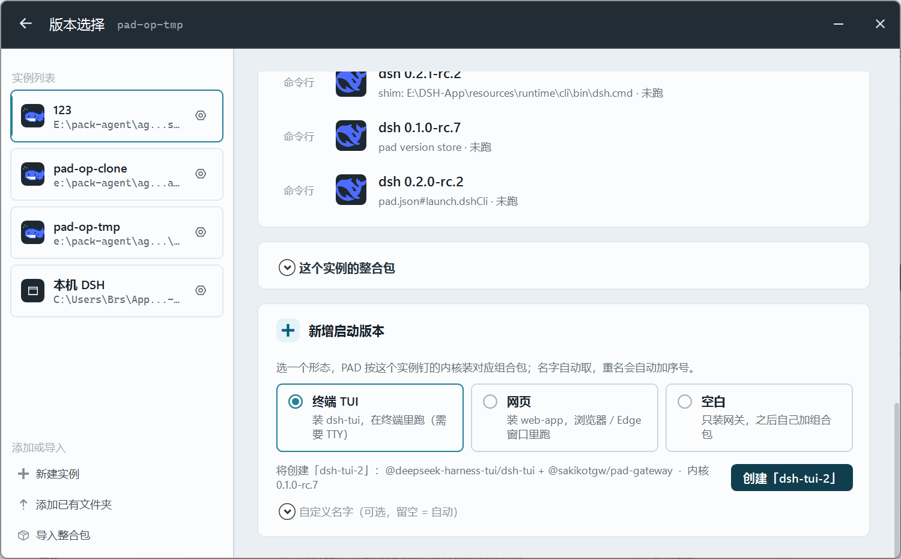

# D39 · 版本选择页：术语与用法三修（用户反馈）

日期：2026-10-27 夜 · 相关：DECISIONS.md D39

用户看版本选择页给了三条反馈，逐条落地：

## 01 · 顶部「插件包」→「整合包」，并显示插件/组件构成

原 UI 把本机搜到的 `.pack.json` / `.pack.zip` 叫「插件包」。用户：*"插件不叫插件包"*；
顶部显示的应该是整合包的插件部分。

改法：
- 标题 / 提示 / 按钮 / 空态 / 弹窗：`插件包` → `整合包`，`用这个包新建实例` → `用这个整合包新建实例`；
- 每行副标题从「组件 9」改为说清构成：`内核 0.1.0-rc.7 · 插件 2 · 技能 3 · MCP 1 · profile web · library`
  （`PackCard.ComponentsText` 中文化：插件 / 技能 / MCP / 规则 / 命令 / 钩子）；
- 底部原来也叫「整合包」的实例白名单展开区改名「这个实例的整合包」，两个概念不再同名。

## 02 · 「终端」→「容器」，列出所有容器让用户选

原「终端 (N)」只列当前实例的 profile（加一行探测到的 TUI）。用户：*"这里底下不该叫这个要叫容器。
列出所有容器让用户自己选。"*

改法：
- 区块改名「容器」（`ContainerList`），提示：`本实例 N 个启动配置 · 本机探测到 M 个容器（桌面端 / TUI / 命令行，点一行收编或切换）`；
- 行首加容器类型标签：`终端 / 网页 / 自定义`（本实例 profile）+ `桌面端 / TUI / 命令行`（本机探测）；
- 探测到的容器全部列出（本机实测 7 个）：
  - 桌面端 ×2：DeepSeek Harness（内核 0.2.1-rc.2 · 在跑 pid 28032 · home）、DSH Desktop（0.2.0-rc.2）、
  - TUI ×1：`dsh-tui（本机）`（包 0.8.3 · 内核 0.1.0-rc.7 · home，可收编）、
  - 命令行 ×4：官方壳内 bin.js / 官方 runtime dsh.cmd shim / PAD 版本库 / pad.json#launch.dshCli；
- 点一行：profile → 打开启动页；探测到的容器且 home 未收编 → 收编成实例；已收编 → 切到那个实例；
  命令行容器（无 home）→ 明确提示不能收编。
- 新增 `DetectedShellRow` / `DetectedCliRow`（与 `DetectedTuiRow` 一样是 `ProfileVm` 子类，
  复用行模板 / 图标 / 在跑标记）。

## 03 · 「安装新版本」填空表单 → 「新增启动版本」点选

原 UI：一个文本框填 profile 名 + 下拉选形态 + 创建。用户：*"我不懂第三张图这个功能咋用……不好用，
你要升级到好用顺手符合逻辑，而不是……做填空题。"*

改法（不再默认填空）：
- 区块改名「新增启动版本」，一句话说明：选形态 → PAD 按实例钉的内核装组合包；
- 三个点选卡片（RadioCard）：`终端 TUI`（dsh-tui，需要 TTY）／`网页`（web-app）／`空白`（只装网关）；
- 名字自动生成：预设名被占用自动加序号（本机实测自动出现 `dsh-tui-2`）；
- 下方实时显示：`将创建「dsh-tui-2」：<组合包列表> · 内核 0.1.0-rc.7`，按钮同文案；
- 想自定义名字才展开「自定义名字（可选，留空 = 自动）」，不挡主路径。

## 验证

- `dotnet build`：0 warning / 0 error；PAD 已用新构建重启。
- 页面实拍：`01-pack-catalog.png`、`02-containers.png`、`03-new-version.png`（`--shot-page versions` + 真实滚屏抓图）。
- 探测数据来自 D36 的 Inventory（同一份 `pad cli discover` 结果）。
