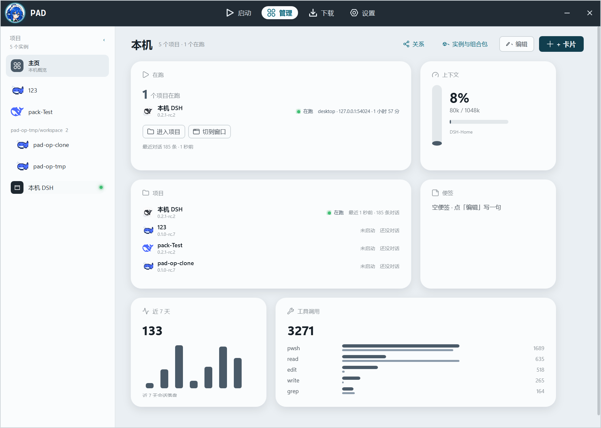
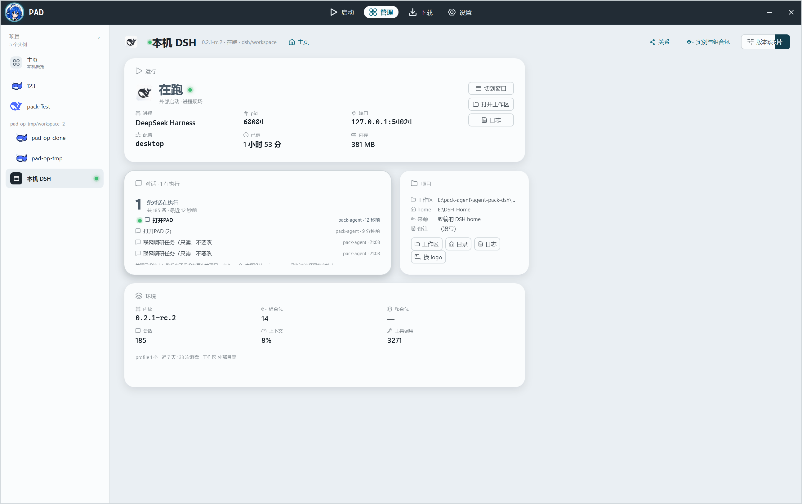

# D60 · 2026-10-31 · 管理主页重排：先"谁在跑"，再"有哪些项目"

用户看到主页（本机概览）后：

> "这页还得优化下"

## 旧主页的问题（按用户自己的三条标准：别放无效信息、先放最想知道的、要读得懂）

| 旧卡 | 问题 |
|---|---|
| 在运行（环 + 数字 2 + 一排灰柱） | 数字不告诉人**是谁**在跑；环和灰柱没有可读含义 |
| 本机 DSH（11 / 内核5·home8） | 载体计数是技术细节，不是打开管理页先要知道的事 |
| 上下文（8%） | 不写是**哪份 home** 的上下文 |
| 项目卡（123，未启动） | 绑的是"上次选中的实例"，不是正在跑的；一张卡只给一个项目 |
| 工具调用 / 近7天 | 历史累计，有用但应排在"在跑/项目"之后 |

## 新默认版面（3 行 × 3 列，全部占满）

```
在跑（2 列，列出在跑项目 + 进入项目/切到窗口 + 最近对话）   上下文（1 列，标 home）
项目（2 列，全部实例行，在跑置顶 + 最近对话；点行进项目页） 便签（1 列，空态给提示）
近 7 天（1 列小柱）                                       工具调用（2 列）
```

- **在跑卡**：`N 个项目在跑` + 每行 logo / 名称 / 版本 / 灯 + `profile · 端口 · 已跑`；
  底部「进入项目」「切到窗口」；再下一行 `共 N 条对话 · 最近 X`。空态写"现在没有项目在跑" + 去启动。
- **项目卡**：读取 `_homeProjects`（实例 + 状态 + 运行现场 + 对话摘要），在跑的置顶、其余按最近对话时间排；
  **点一行 = ShowScope(该实例)**，和左栏同一个入口；总数写在页头，不在卡底重复。
- **上下文卡**：底部标出 `ShortHome(home)`（如 `DSH-Home`），不再让人猜。
- **近 7 天**：单列版（大数字 + 七根小柱）；工具调用保持两列。
- **页头**：主页显示 `N 个项目 · M 个在跑`（原来只有项目页有 meta）。
- **载体计数（本机 DSH）退出默认版面**，仍留在「+ 卡片」目录里，想要的人可以加回来。
- **数据源**：`Dialogs.Summary(home)` 只数目录 + 读 mtime，**不解析** session JSON——
  185 份 1MB 缓存的解析不能压在主页首屏。
- **版面迁移**：pad.json 里若是旧的 7 张默认卡（D28 那套顺序/视图完全一致），自动换成新默认；
  用户自己改过版面就不动。

## 验证（最终构建）




- 页头：`本机  5 个项目 · 1 个在跑`；在跑卡一行 `本机 DSH · 0.2.1-rc.2 · 在跑 · desktop · 127.0.0.1:54024 · 1小时57分`，
  下面 `进入项目 / 切到窗口` + `最近对话 185 条 · 1 秒前`；
  项目卡在跑置顶（`在跑 · 最近 1 秒前 · 185 条对话`），其余 `未启动 · 还没对话`；
  上下文标 `DSH-Home`；便签空态 `空便签 · 点「编辑」写一句`。
- 交互实测：点项目卡第一行 → 页头出现「主页」、卡片换成「运行/对话/项目/环境」= 已进项目页（截图 `project.png`）。
- `dotnet build` 0 warning / 0 error；`pad-window` 新增 D60 断言（旧默认识别/迁移、新默认类型、
  `HomeProject` + `Dialogs.Summary`、行点进项目页、空态、上下文标 home、页头 meta、Summary 不解析 JSON）；
  `pad-window` / `pad-depth` / `pad-pack` 绿。

## 截图说明

窗口被其它置顶窗口（微信/QQ）挡着时 `CopyFromScreen` 会截到别人；本证据用 `PrintWindow(PW_RENDERFULLCONTENT)`
按窗口句柄渲染，和实际窗口内容一致。自动化里 PAD 被最小化时先 `ShowWindow(SW_RESTORE)` 再截。

## 边界

- 项目卡只放 4 行（226 高放不下 5 行）；第 5 个及以后在左栏，页头写总数。
- 每行的"对话摘要"来自文件 mtime + 文件数，不是 DSH 的管理口；管理口数据仍只用于项目页的"对话"卡。
- 版面迁移只在"完全等于旧默认"时触发，不动自定义版面。
