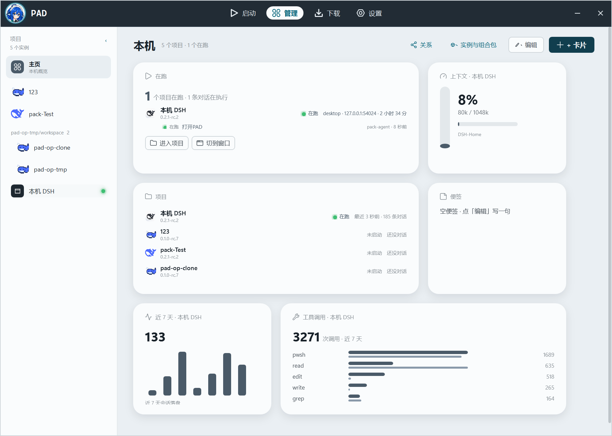

# D61 · 2026-10-31 · 第一眼要看见"在跑啥"，每张卡要写"是谁的"

用户（D60 之后）：

> "主要是第一眼得看件是啥意思在跑啥。上下文就不知道是谁上下文。。。工具调用也是"

三个问题，一条原则：**主页的数字必须带主体，在跑卡必须带内容。**

## 1) 在跑卡：从"有几个在跑"到"在跑啥"

- 卡头：`1 个项目在跑 · 1 条对话在执行`（执行条数来自最近对话的 `Executing`）。
- 项目行下面直接列对话行：`● 在跑  打开PAD  ……  pack-agent · 8 秒前`
  —— 灯 + "在跑/最近" + 对话标题 + 工作区 + 时间；最多 2 行（跨项目共用预算，卡高 226 放得下）。
- 数据：`HomeProject` 增加 `IReadOnlyList<DialogRow> Recent`；在跑项目在加载时
  `Dialogs.Read(home, 4)`（只读 4 份缓存，不是全量），失败就只留状态词。
- 没有可列对话时补一行 `最近 N 条对话 · 最新 X`，不重复。

## 2) 上下文卡：标题写清是谁的

- 标题从 `上下文` → `上下文 · 本机 DSH`（`HomeOwner()`：正在跑的那份 home 属于哪个实例，
  找不到就退回第一个在跑的）。卡内仍保留 `DSH-Home` 路径小字，tooltip 给完整 home。

## 3) 工具调用卡：写清是谁的、哪段时间的

- 标题 → `工具调用 · 本机 DSH`；数字后直接写口径：`3271 次调用 · 近 7 天`。
- 近 7 天卡标题同样带主体：`近 7 天 · 本机 DSH`。

## 验证（最终构建）

- 在跑卡一眼可读：`1 个项目在跑 · 1 条对话在执行` → `本机 DSH 0.2.1-rc.2 在跑 desktop 127.0.0.1:54024 2小时34分`
  → `● 在跑 打开PAD  pack-agent · 8 秒前` → `进入项目 / 切到窗口`；
- 上下文卡：`上下文 · 本机 DSH`；工具调用卡：`工具调用 · 本机 DSH` + `3271 次调用 · 近 7 天`；
- 近 7 天卡：`近 7 天 · 本机 DSH`。
- `dotnet build` 0 warning / 0 error；`pad-window` 新增 D61 断言（`Recent` + `Dialogs.Read(inst.Home, 4)`、
  `HomeDialogLine`、`条对话在执行`、`HomeOwner`、标题带 `{owner.Inst.Name}`、`次调用 · 近 7 天`、
  旧"最近对话 N 条"占位行已删）；`pad-window` / `pad-depth` / `pad-pack` 绿。

## 边界

- 在跑对话来自投影缓存（openStep / pendingCalls），不是 DSH 管理口的 session.list；管理口数据仍只在项目页。
- 只读 4 份对话文件，避免主页首屏解析全部缓存。
- 主体归属取"正在跑的那份 home"；如果机器上有多个 home 同时在跑，卡只标一个（第二个在项目列表里）。
