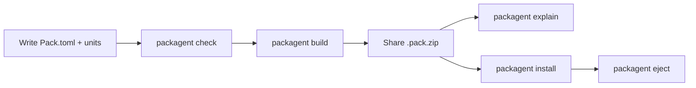
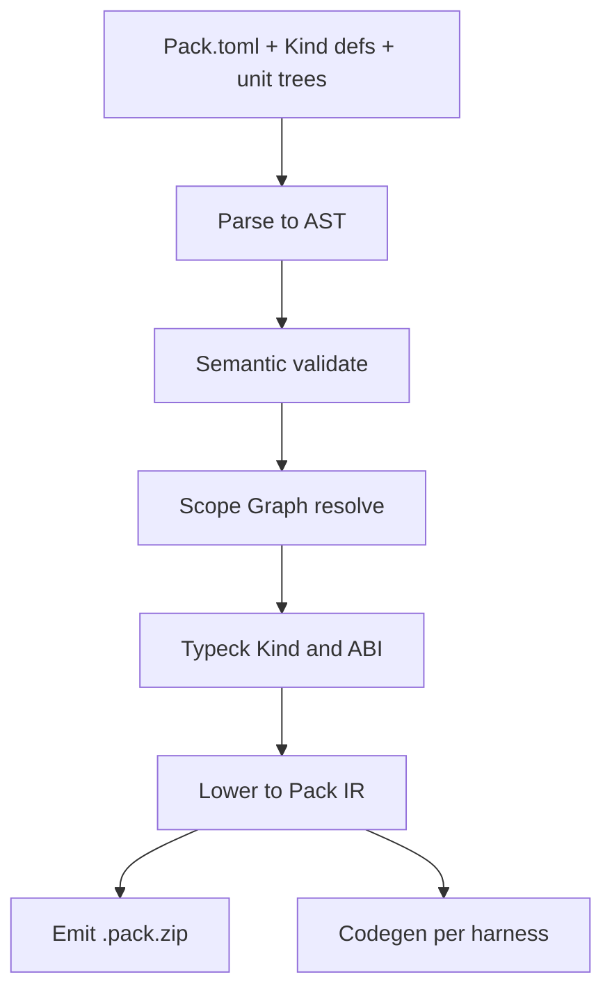

# Agent Pack Language（APL）Implementation Plan

> **For agentic workers:** REQUIRED SUB-SKILL: Use superpowers:subagent-driven-development (recommended) or superpowers:executing-plans to implement this plan task-by-task. Steps use checkbox (`- [ ]`) syntax for tracking.

**Goal:** 把 pack-agent 建成 Agent 界的「LaTeX / Markdown / MATLAB」——一门有语法、类型、链接与多后端语义的语言 + 处理器，使人能用严格规章编写、校验、分享、跨 harness 投射 agent 能力（skill / loop / engineering / 跨层通话）。

**Architecture:** 源语言 `Pack.toml` + Kind 规章 → 编译管线（parse → AST → typeck/resolve → IR）→ 多 harness codegen；stdlib Kind 如 WASI，方言 Kind（如 `cos.collab`）可插拔；旧 `ccui-pack` 仅为遗留 IR 升格前端。

**Tech Stack:** TypeScript · Bun · TOML 源 · JSON Schema · 现有 adapters/ledger · 可选沙箱 JS processor

**关联：** Cursor 计划 `agent_pack_language_cca7a69d` · Board `tasks/apl-language.md`

---

## 0. 终极目标

### 一句话

**写一次 agent 能力源，经处理器校验与链接，投射到任意 harness——像 Markdown→HTML、LaTeX→PDF、MATLAB→数值结果。**

### 领域对标（我们在做什么）

| 领域语言 | 人写什么 | 处理器做什么 | 产物 | Agent 界对应 |
|----------|----------|--------------|------|----------------|
| **Markdown** | 结构化纯文本 | 解析 → AST → 渲染 | HTML / 预览 | Pack 源 → 可读 explain + 可装树 |
| **LaTeX** | 排版语义源 | tex → DVI/PDF；宏包扩展 | PDF | Kind 方言 = 宏包；edition = 引擎版本 |
| **MATLAB** | 矩阵/算法语言 | 解释/JIT；工具箱生态 | 数值/图 | loop / engineering 工具箱；stdlib = 基础工具箱 |
| **I❤️LA** | 可编译的「像黑板的」线性代数 | 一源多后端 | LaTeX + Python + MATLAB + C++ | **同一 Pack 源 → Cursor + Claude + Codex + …** |

今天的 agent 配置 = **手写汇编 + 口头约定**：拷目录、猜路径、别人不知道你的 `.collab` 是什么。

终极态：

1. **作者**用 APL 声明 Kind / Unit / World / ABI（有专用语法，不是随便 JSON）
2. **`packagent check`** 像 rustc/tex：错就拒，并给稳定错误码
3. **`packagent build`** 产出 IR + `.pack.zip`（可分发工件）
4. **`packagent install`** 多 harness 投射；**`eject`** 可卸
5. **`packagent explain`** 任何人打开包都知道「是什么、依赖什么、导出什么」
6. **生态**：社区发布方言 Kind（engineering 方法、collab 规章、loop 契约），像 CTAN / MATLAB Toolbox / Markdown 扩展，而不是改 pack-agent 内核

### 成功画像（2030 心智，现在按此验收）

- 新手：照 Book 写一个 skill+command 包，在两个 harness 装上
- 方法作者：发布 `cos.collab` 类方言 Kind，他人 `use` 即可，无需 fork pack-agent
- 团队：World 固定 exports/imports，CI 跑 `packagent check` 卡 ABI 回归
- 行业：谈「agent 包」时默认有语言与处理器，散文件拷贝被视为过时

### 非终极（边界）

- 不取代 Cursor/Claude 内部真正跑 loop 的运行时（我们搬契约与配置）
- 不做中央商店（先语言+处理器；索引可后接）
- 不把 Cos Collab / CBL 焊成北极星产品

---

## 1. 分工

| 角色 | 职责 | 主要产物 | 谁做（本仓） |
|------|------|----------|--------------|
| **语言设计** | Glossary、元模型、语法、语义规则、错误码 | `docs/GLOSSARY.md` `docs/LANGUAGE.md` | 主线程 / 文档任务 |
| **类型与链接** | Kind 作类型、Scope Graph、World/ABI | `src/lang/typeck.ts` `resolve.ts` `link.ts` | 实现任务 |
| **处理器核心** | 编译管线驱动、diagnostics、CLI 动词 | `src/lang/*` `cli` 子命令 | 实现任务 |
| **stdlib Kind** | `agent.skill` 等默认 Trait 实现 | `src/kinds/*.kind.json` + trait 适配现有 scan/install | 实现任务 |
| **Harness backend** | IR → 各壳目录 | `src/codegen/*`（收编 adapters） | 实现任务 |
| **方言样例** | `cos.collab` Kind + 样例包 | `examples/kinds/` `examples/packs/` | 样例任务 |
| **方法论验证** | 正反 fixture、跨 harness 金样、explain 快照 | `test/lang/*` | 每任务强制 |
| **兼容** | 旧 pack 升格 | `src/lang/upgrade.ts` | 兼容任务 |
| **产品叙事** | NORTH_STAR / Book / README | `docs/NORTH_STAR.md` `docs/BOOK.md` | 文档任务 |

**禁止：** 单人把「方言产品」（Cos Collab）写进内核当模块枚举——那是错类分工。

---

## 2. 流程

### 2.1 作者/用户流程（产品）



### 2.2 处理器内部流程（编译管线）



### 2.3 本仓协作流程（Cos Collab 执行协议）

1. Board 取 `tasks/apl-language.md`（或拆出的子任务）一条
2. 按本计划 Task 顺序：先红测 → 实现 → 绿测 → 再下一项
3. 每完成一个可验收切片：更新 ROADMAP + 任务勾选
4. 方法论验证门禁未过 → 禁止声称「语言层完成」

### 2.4 方言扩展流程（生态）

1. 作者写 `*.kind.json`（layout + schema + abi + 可选 processor）
2. Pack `[[unit]] kind = "vendor.foo"`
3. `check` 加载 Kind；失败则拒
4. 他人只依赖 Kind 包，不改 pack-agent

---

## 3. 方法论验证（如何证明我们没自嗨）

| 方法主张 | 可证伪实验 | 通过标准 |
|----------|------------|----------|
| 「这是语言」 | 存在专用语法 + 元模型 + 类型/链接 + 到 harness 的语义 | Book/Reference/IR 三分；`check` 拒非法程序 |
| 「别人能看懂」 | 陌生包跑 `explain` | 输出含 Kind 用途、World、ABI；无神秘模块名 |
| 「可扩展」 | 不改 `src/` 核心，只加 `examples/kinds/foo.kind.json` 打包装卸 | install/eject 成功；ledger 可卸 |
| 「跨层通话简单」 | skill export + loop/command import 故意断链 | `E-ABI-UNSATISFIED`；修好后 check 过 |
| 「一源多后端」 | 同一 zip install 到 ≥2 个检测到的 harness | 两边文件就位；eject 干净 |
| 「方言非内核」 | 仓内无 `PackModuleId = 'collab'` | collab 仅作 `cos.collab` 样例 |
| 「旧世界不炸」 | 升格 `ccui-pack/v0.2` 样例包 | `check`/`install` 仍可用 |

**验证资产目录：** `test/lang/`（语法/类型）、`test/kinds/`（stdlib+方言）、`test/golden/explain/`（快照）、`test/upgrade/`（旧包）。

**每 Task 出门前：** 至少一条正例 + 一条反例（该阶段错误码）绿。

---

## 4. 文件地图

| 路径 | 职责 |
|------|------|
| `docs/GLOSSARY.md` | 术语 |
| `docs/LANGUAGE.md` | Reference（真相） |
| `docs/BOOK.md` | 教程 |
| `docs/KINDS.md` | stdlib 目录 |
| `docs/PACK_SPEC.md` | **IR** 规范（降级为汇编层） |
| `docs/NORTH_STAR.md` | 北极星改为 APL |
| `src/lang/ast.ts` | AST 类型 |
| `src/lang/parse.ts` | Pack.toml + Kind 加载 |
| `src/lang/diagnostics.ts` | 错误码与 span |
| `src/lang/resolve.ts` | Scope Graph |
| `src/lang/typeck.ts` | Kind/ABI 检查 |
| `src/lang/ir.ts` | Pack IR 类型 |
| `src/lang/lower.ts` | AST → IR |
| `src/lang/check.ts` | 管线入口 check |
| `src/lang/build.ts` | build → zip |
| `src/lang/explain.ts` | 人读输出 |
| `src/lang/upgrade.ts` | 旧 IR 升格 |
| `src/kinds/*.kind.json` | stdlib |
| `src/codegen/` | harness backends |
| `examples/kinds/cos.collab.kind.json` | 方言样例 |
| `src/modules.ts` | 过渡糖 → 最终删除 `collab` 枚举 |

---

## 5. 语言核心（实现时钉死）

### Edition

`edition = "2026"`；未知 → `E-EDITION-UNKNOWN`。

### Kind / Unit / World / ABI

见既有设计；World 闭合 imports/exports；链接失败硬错误。

### Trait

`Describe | Validate | Scan | Embed | Project | Eject | ExportAbi | ImportAbi`。

### CLI

`packagent check | build | install | eject | explain | dump-ir`。

### 错误码（稳定）

`E-EDITION-UNKNOWN` `E-KIND-NOT-FOUND` `E-LAYOUT-MISSING` `E-SCHEMA-INVALID` `E-RESOLVE-FAILED` `E-ABI-UNSATISFIED` `E-ABI-CONFLICT` `E-PORTABILITY-LEAK` `E-PROCESSOR-CAP`。

---

## 6. Tasks

### Task 1: 北极星 + Glossary + 愿景钉死

**Files:**
- Modify: `docs/NORTH_STAR.md`
- Create: `docs/GLOSSARY.md`
- Create: `docs/APL_VISION.md`（终极目标与 LaTeX/MD/MATLAB 对标短文，对外可引用）

- [x] **Step 1:** 重写 `NORTH_STAR.md` 一句话为 APL 语言+处理器；明确 Cos/CBL 仅样例
- [x] **Step 2:** 写 Glossary：Pack, Kind, Unit, World, ABI, Edition, IR, Harness, Trait, Dialect, Processor
- [x] **Step 3:** 写 `APL_VISION.md`：复制本计划 §0 对标表与成功画像（可略压缩）
- [x] **Step 4:** 自检：三份文档无「CBL 优先」「第一版阉割目标」表述

### Task 2: LANGUAGE Reference 骨架 + 错误码表

**Files:**
- Create: `docs/LANGUAGE.md`

- [x] **Step 1:** 写 Edition / 词法约定（TOML 子集）/ 产生式级 Manifest 结构
- [x] **Step 2:** 写 Kind 规章必填字段表、Trait 列表、World/ABI 规则
- [x] **Step 3:** 写错误码表（码 → 含义 → 修复提示）
- [x] **Step 4:** 写「语义」一节：check/build/install 各改什么、失败时无副作用

### Task 3: Diagnostics + AST 类型（红测先行）

**Files:**
- Create: `src/lang/diagnostics.ts`
- Create: `src/lang/ast.ts`
- Create: `test/lang/diagnostics.test.ts`

- [x] **Step 1:** 写失败测试：构造 `E-EDITION-UNKNOWN` 诊断，断言 `code` 与 `message` 稳定

```ts
import { describe, expect, test } from 'bun:test'
import { diag, formatDiag } from '../src/lang/diagnostics.ts'

test('E-EDITION-UNKNOWN is stable', () => {
  const d = diag('E-EDITION-UNKNOWN', { edition: '1999' })
  expect(d.code).toBe('E-EDITION-UNKNOWN')
  expect(formatDiag(d)).toContain('1999')
})
```

- [x] **Step 2:** 跑测确认失败（模块不存在）
- [x] **Step 3:** 实现 `diagnostics.ts`（码枚举 + `diag` + `formatDiag`）与最小 `ast.ts`（PackAst, UnitAst, WorldAst）
- [x] **Step 4:** 绿测

### Task 4: Parse Pack.toml（最小可解析）

**Files:**
- Create: `src/lang/parse.ts`
- Create: `test/lang/parse.test.ts`
- Depend: 需 `smol-toml` 或手写最小 TOML；优先仓内已有依赖，无则加 `smol-toml`

- [x] **Step 1:** 红测：解析含 `edition`/`name`/`[[unit]]` 的 fixture
- [x] **Step 2:** 实现 `parsePackToml(text): PackAst`
- [x] **Step 3:** 未知 edition 不在 parse 杀（留给 typeck）；缺 `name` → 校验错误在 check
- [x] **Step 4:** 绿测

### Task 5: check 管线最小闭环（edition + kind 存在）

**Files:**
- Create: `src/lang/check.ts`
- Create: `src/kinds/agent.skill.kind.json`（最小 Describe + layout）
- Create: `test/lang/check.test.ts`
- Modify: `src/cli.ts`（或命令注册处）加 `check` 子命令

- [x] **Step 1:** 红测：edition `1999` → `E-EDITION-UNKNOWN`；kind `no.such` → `E-KIND-NOT-FOUND`
- [x] **Step 2:** 实现 Kind 加载（读 `src/kinds/` + 可选 `kinds/` 工作区）
- [x] **Step 3:** `check` 串联 parse → edition → kind resolve
- [x] **Step 4:** CLI `packagent check path/to/Pack.toml` 打印诊断；exit 1 on error
- [x] **Step 5:** 绿测

### Task 6: Explain + Describe 强制

**Files:**
- Create: `src/lang/explain.ts`
- Create: `test/lang/explain.test.ts`
- Modify: CLI

- [x] **Step 1:** 红测：Kind 缺 `describe.title` → check 失败
- [x] **Step 2:** `explain` 打印 name、edition、各 unit 的 kind + title + abi
- [x] **Step 3:** 绿测 + 金样字符串

### Task 7: Lower → IR → build zip

**Files:**
- Create: `src/lang/ir.ts` `src/lang/lower.ts` `src/lang/build.ts`
- Create: `test/lang/build.test.ts`
- Modify: 复用 `src/pack-archive.ts`

- [x] **Step 1:** 定义 `PackIr`（`schema: agent-pack-ir/2026`）
- [x] **Step 2:** 红测：最小 Pack.toml build 出 zip，内含 `pack.json` IR
- [x] **Step 3:** 实现 lower + build
- [x] **Step 4:** 绿测

### Task 8: ABI / World 链接

**Files:**
- Create: `src/lang/resolve.ts` `src/lang/typeck.ts`（或扩展 check）
- Create: `test/lang/link.test.ts`

- [x] **Step 1:** 红测：import 未满足 → `E-ABI-UNSATISFIED`；双 export 冲突 → `E-ABI-CONFLICT`
- [x] **Step 2:** Scope Graph：pack scope 内 declarations = unit names + exports
- [x] **Step 3:** 绿测

### Task 9: stdlib Kind 收编现有 scan/install

**Files:**
- Create: 其余 `src/kinds/agent.*.kind.json`
- Modify: `src/scan-modules.ts` `src/install-modules.ts` 改为经 Kind Trait 调度
- Create: `test/kinds/stdlib-roundtrip.test.ts`

> **部分完成：** stdlib kind 规章 + `getStdlibInstallTemplate` + check 已落地；`scan-modules` / `install-modules` 仍走 legacy 路径。

- [x] **Step 1:** 为 skill/rule/mcp/command 写 kind 规章
- [ ] **Step 2:** install 路径从 kind.install 模板读（legacy install 仍主导）
- [x] **Step 3:** 现有 pack zip 样例仍能装（升级路径或双读）
- [x] **Step 4:** 绿测 roundtrip

### Task 10: 方言 `cos.collab` + 删除内置 collab 模块

**Files:**
- Create: `examples/kinds/cos.collab.kind.json`
- Modify: `src/modules.ts` 等删除 `collab`
- Create: `test/kinds/cos-collab.test.ts`

- [x] **Step 1:** Kind 描述 `.collab/**` layout + portability 排除 FOUNDATION/traps
- [x] **Step 2:** 样例 Pack.toml 引用该 kind，check/build/install
- [x] **Step 3:** 删除 `PackModuleId` 的 `collab`；文档不再列内置 collab
- [x] **Step 4:** 绿测

### Task 11: 多 harness codegen + 旧包升格

**Files:**
- Create: `src/lang/upgrade.ts` `src/codegen/`（薄封装现有 adapters）
- Create: `test/upgrade/v02.test.ts`

> **部分完成：** `upgradePackDocToIr` + v0.2 测试绿；legacy adapters 仍服务 install；独立 `src/codegen/` 未建；IR zip install 未接。

- [x] **Step 1:** 读 `ccui-pack/v0.2` → IR 2026
- [ ] **Step 2:** install 走 IR → codegen（legacy install 仍可用）
- [x] **Step 3:** ≥1 个旧导出包 fixture 升格后 install（legacy `test/install.ts` / `test/pack-zip.ts`）
- [x] **Step 4:** 绿测

### Task 12: Book + KINDS + PACK_SPEC 降为 IR + 方法论验证清单勾满

**Files:**
- Create: `docs/BOOK.md` `docs/KINDS.md`
- Modify: `docs/PACK_SPEC.md` `README.zh-CN.md`
- Modify: `.collab/board/ROADMAP.md` 任务状态

- [x] **Step 1:** Book：从零写一个包到 explain/install
- [x] **Step 2:** KINDS 列出 stdlib；PACK_SPEC 标题改为 IR
- [x] **Step 3:** 跑一遍 §3 方法论验证表，写入 `docs/APL_VERIFY.md`
- [x] **Step 4:** README 入口指向 Book / LANGUAGE

---

## 7. 自我审查

| 规格点 | 对应 Task |
|--------|-----------|
| 终极目标 / 对标 LaTeX·MD·MATLAB | §0 + Task 1 |
| 分工 | §1 |
| 流程 | §2 |
| 方法论验证 | §3 + 各 Task 红绿测 + Task 12 |
| 编译管线 | Task 3–7 |
| World/ABI | Task 8 |
| stdlib | Task 9 |
| 方言非内核 | Task 10 |
| 多后端 + 升格 | Task 11 |
| 文档三分 | Task 1–2, 12 |

占位符扫描：无 TBD/「以后再写实现」。

---

## 8. 执行交接

Plan 已保存至 `docs/superpowers/plans/2026-07-30-agent-pack-language.md`。

**执行选项：**

1. **Subagent-Driven（推荐）** — 每 Task 新开子代理，Task 间审查  
2. **Inline Execution** — 本会话按 executing-plans 连续做，设检查点  

回复选 **1** 或 **2** 即开始实现。
